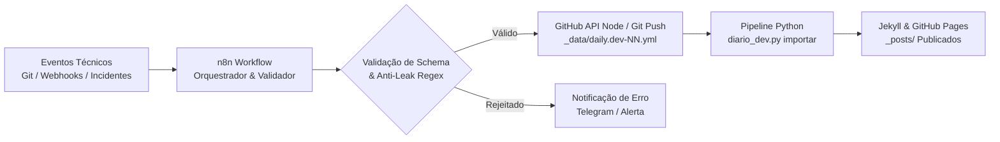

# 🌐 araguaci.github.io • Artes do Sul & Araguaci Dev Hub

## 🛡️ Sentinel Status
- **Status:** 🟢 Produção
- **Tier:** A
- **Health:** 98% / **ROI Potencial:** Hub Central de Conteúdo, Engenharia & Automação
- **Stack:** Jekyll, Ruby 3, Python 3, YAML, Liquid, GitHub Pages, n8n, Docker, WSL, HTML5/CSS3

---

Portal oficial, hub técnico de engenharia e blog de aprendizados contínuos (**Diário de Desenvolvimento / Daily.Dev**) de **Araguaci Carlos de Andrade** ([Artes do Sul](https://www.artesdosul.com)). O projeto integra publicação web estática de alta velocidade via Jekyll e GitHub Pages, esteiras de ingestão automatizada em Python, orquestração de fluxos com **n8n**, e governança editorial com controle estrito de metadados e blindagem de credenciais sensíveis.

---

## 📑 Sumário

- [🛡️ Sentinel Status & Visão Geral](#️-sentinel-status)
- [🏗️ Arquitetura do Repositório](#️-arquitetura-do-repositório)
- [📓 Diário de Desenvolvimento (Daily.Dev Pipeline)](#-diário-de-desenvolvimento-dailydev-pipeline)
  - [Conceito e Princípios (SKILL.md)](#conceito-e-princípios-skillmd)
  - [Comandos de Linha de Comando (CLI)](#comandos-de-linha-de-comando-cli)
- [⚡ Automação com n8n & Ferramentas de Ingestão](#-automação-com-n8n--ferramentas-de-ingestão)
  - [Fluxo de Dados e Integração](#fluxo-de-dados-e-integração)
  - [Passo a Passo de Acesso e Configuração de Credenciais](#passo-a-passo-de-acesso-e-configuração-de-credenciais)
  - [Payload Contratual de Entrada (Webhook / API)](#payload-contratual-de-entrada-webhook--api)
  - [Blindagem de Segurança e Idempotência](#blindagem-de-segurança-e-idempotência)
- [📐 Esquema de Dados e Governança Editorial](#-esquema-de-dados-e-governança-editorial)
- [🚀 Instalação e Execução Local](#-instalação-e-execução-local)
- [👨‍💻 Perfil do Autor / About Me](#-perfil-do-autor--about-me)
  - [Versão em Português](#-português)
  - [English Version](#-english)
- [🌊 Projetos Sociais & Parcerias](#-projetos-sociais--parcerias)
- [🌐 Presença Online & Contato](#-presença-online--contato)

---

## 🏗️ Arquitetura do Repositório

O repositório combina o motor de geração de sites Jekyll (tema *Beautiful Jekyll*) com utilitários de engenharia de dados em Python:

```text
araguaci.github.io/
├── _data/                       # Fontes de dados estruturadas (YAML / JSON)
│   ├── daily.dev-01.yml         # Volume 1: DEV-2026-001 a DEV-2026-016 (DevOps, Shaders, PWA)
│   ├── daily.dev-02.yml         # Volume 2: DEV-2026-017 a DEV-2026-032 (PWAs Táticos, MCP, FTPS)
│   ├── daily.dev-03.yml         # Volume 3: DEV-2026-033 a DEV-2026-048 (Lorentz, Omnichannel, CTI)
│   ├── export/                  # Arquivos gerados dinamicamente (índices e espelhos)
│   └── templates/               # Modelos e schemas canônicos
│       ├── diario.entrada.modelo.yml
│       ├── diario.entrada.schema.json
│       └── diario.volume.modelo.yml
├── _posts/                      # Artigos publicados em Markdown (gerados a partir dos YAMLs)
├── docs/                        # Guias detalhados de governança e roteiro da automação
│   ├── diario-dev-2026-guia.md
│   └── roteiro-automacao-diario-dev.md
├── diario_dev.py                # CLI para validação, índice, exportação e novos lotes
├── import_daily_dev.py          # Parser e compilador dos volumes YAML para Markdown em _posts/
├── _config.yml                  # Configurações globais do Jekyll e metadados SEO
├── aboutme.md                   # Página pessoal canônica
└── index.html                   # Feed principal do portal
```

---

## 📓 Diário de Desenvolvimento (Daily.Dev Pipeline)

O Diário de Desenvolvimento converte descobertas práticas de engenharia em registros estruturados e artigos no blog. O modelo segue as diretrizes da automação e da skill canônica `diario_dev` (`C:\Users\aragu\.cursor\skills\diario_dev\SKILL.md`).

### Conceito e Princípios (SKILL.md)
1. **A fonte é o YAML**: Todo aprendizado nasce em um arquivo `_data/daily.dev-NN.yml`. O arquivo `.md` em `_posts/` é um artefato gerado.
2. **Entender antes de registrar**:
   - Qual foi o incidente ou descoberta (em uma frase).
   - Qual o mecanismo técnico (arquivo, porta, comando, versão, causa raiz).
   - Evidência factual auditável (commit, changelog, código ou conversa de bancada).
   - Um tema por entrada (não agrupar assuntos desconexos nem gerar um artigo por mero commit).
3. **Imutabilidade e Idempotência**: Volumes já marcados com `status: pronto` não são reabertos para novos temas; novos temas iniciam um novo volume.

### Comandos de Linha de Comando (CLI)

```bash
# 1. Gerar e consultar o índice consolidado de entradas existentes
python diario_dev.py indice

# 2. Descobrir o próximo ID disponível (ex: DEV-2026-049)
python diario_dev.py proximo

# 3. Criar um novo volume quando o lote anterior estiver fechado
python diario_dev.py novo

# 4. Validar sintaxe, regras e schema JSON do volume
python diario_dev.py validar _data/daily.dev-03.yml

# 5. Ingerir e compilar artigos Markdown apenas para o volume especificado
python diario_dev.py importar _data/daily.dev-03.yml

# 6. Auditar integridade entre entradas do YAML e arquivos em _posts/
python diario_dev.py verificar
```

---

## ⚡ Automação com n8n & Ferramentas de Ingestão

Ferramentas de orquestração como o **n8n** (self-hosted ou cloud) atuam como hubs de integração para coletar eventos técnicos (git commits, alertas de deploy, finalização de sprints, chamados resolvidos) e despachá-los diretamente para a esteira de publicação do diário.



### Fluxo de Dados e Integração

1. **Trigger de Entrada (Webhook / Cron)**: O n8n escuta eventos via Webhook HTTP seguro ou executa rotinas agendadas (ex: leitura de changelogs ou commits diários de monorepos como `lorentz-vps-stack`, `supervisor` e `omnichannel`).
2. **Processamento & Filtro no n8n**:
   - Extrai o resumo executivo, a causa raiz e o snippet de código.
   - Aplica a sanitização estrita de segurança (bloqueio de senhas, chaves privadas, tokens e IPs internos).
   - Atribui ou solicita o próximo identificador sequencial `DEV-AAAA-NNN`.
3. **Escrita no Repositório**:
   - Via nó nativo **GitHub Node** do n8n (atualização do YAML em `_data/`).
   - Ou via **SSH Node / Execute Command** em ambiente homelab/VPS para rodar `python diario_dev.py validar` e `python diario_dev.py importar`.
4. **Deploy Automatizado**: O push no GitHub dispara a GitHub Action do Jekyll, que publica os novos artigos em produção no GitHub Pages.

### Passo a Passo de Acesso e Configuração de Credenciais

Para habilitar o n8n ou outro orquestrador a operar neste repositório:

1. **Gerar Token de Acesso GitHub (PAT)**:
   - Em *GitHub Settings > Developer Settings > Personal Access Tokens (Fine-Grained ou Classic)*.
   - Conceder permissão de leitura e escrita (`Contents: Read and write`) no repositório `araguaci/araguaci.github.io`.
   - Se o n8n for acionar workflows via `repository_dispatch`, conceder permissão em `Workflows: Read and write`.
2. **Cadastrar Credencial no n8n**:
   - No painel do n8n, acesse *Credentials > Add Credential > GitHub API*.
   - Cole o Personal Access Token gerado e teste a conexão.
3. **Configuração de Segurança do Webhook de Entrada**:
   - No nó **Webhook** do n8n, configure *Authentication* como `Header Auth`.
   - Crie uma credencial com cabeçalho `X-N8N-Webhook-Secret` e um token aleatório de alta entropia.
   - Todas as requisições de clientes remotos devem incluir esse header para evitar disparos maliciosos.
4. **Variáveis de Ambiente Recomendadas (n8n Docker / VPS)**:
   ```env
   N8N_ENFORCE_SETTINGS_FILE_PERMISSIONS=true
   GITHUB_DAILYDEV_REPO="araguaci/araguaci.github.io"
   DAILYDEV_WORKSPACE_PATH="/workspace/araguaci.github.io"
   ```

### Payload Contratual de Entrada (Webhook / API)

Ao enviar uma nova lição de desenvolvimento via HTTP POST para o webhook do n8n:

```json
{
  "id": "DEV-2026-035",
  "date": "2026-10-01",
  "title": "Orquestração de Ingestão com n8n e Blindagem de Credenciais em Repositórios Públicos",
  "category": "devops",
  "tags": ["n8n", "automacao", "seguranca", "jekyll", "webhooks"],
  "slug": "orquestracao-ingestao-n8n-blindagem-credenciais-repositorios",
  "summary": "O n8n captura eventos técnicos e valida o schema antes de registrar no repositório. Credenciais e chaves privadas são sanitizadas automaticamente.",
  "problem_statement": "Submeter aprendizados manuais a cada incidente causava atraso de documentação e risco de vazamento involuntário de variáveis de ambiente.",
  "key_learnings": [
    "O nó Webhook com Header Auth garante que apenas agentes autorizados criem rascunhos.",
    "A regex anti-secret no n8n rejeita payloads que contenham padrões como ghp_, AKIA ou chaves privadas.",
    "A ingestão via GitHub API preserva o versionamento sem necessidade de clonar o repositório completo."
  ],
  "code_snippet": "curl -X POST https://n8n.example.com/webhook/daily-dev \\\n  -H 'X-N8N-Webhook-Secret: seu_token_aqui' \\\n  -H 'Content-Type: application/json' \\\n  -d @payload.json",
  "impact_value": "Zero atrito para documentar incidentes de infraestrutura mantendo 100% de conformidade de segurança.",
  "related_projects": ["lorentz-n8n", "araguaci.github.io"]
}
```

### Blindagem de Segurança e Idempotência

- **Sanitização Obrigatória**: O script [`diario_dev.py`](diario_dev.py) e o nó do n8n barram automaticamente chaves privadas (`BEGIN PRIVATE KEY`), tokens de provedores (`AKIA*`, `ghp_*`, `xox*`) e atribuições de senhas ou strings de conexão.
- **Checagem de Duplicatas**: Antes de gravar, o sistema consulta `_data/export/diario.indice.yml`. Se o ID, o slug ou o título do mesmo incidente já existirem, o registro é rejeitado para manter a idempotência.

---

## 📐 Esquema de Dados e Governança Editorial

Cada entrada de aprendizado obedece estritamente ao contrato definido em [`_data/templates/diario.entrada.schema.json`](_data/templates/diario.entrada.schema.json):

| Campo | Tipo | Restrições / Validação | Descrição |
|---|---|---|---|
| `id` | String | `^DEV-[0-9]{4}-[0-9]{3}$` | Identificador sequencial com ano (ex: `DEV-2026-033`). |
| `date` | String | `AAAA-MM-DD` | Data exata em que o aprendizado foi consolidado. |
| `title` | String | 12 a 140 caracteres | Frase declarativa do que foi aprendido. |
| `category` | Enum | Lista restrita | `devops`, `frontend`, `backend`, `osint`, `iot`, `datascience`, `ia`, `infraestrutura`, `saas`, `seguranca`, `telefonia`, `arquitetura`, `conteudo`, `windows`. |
| `tags` | Array | 2 a 8 itens | Termos técnicos em kebab-case ou lowercase, sem espaços. |
| `slug` | String | Até 80 caracteres | Nome da URL e do arquivo gerado (`AAAA-MM-DD-slug.md`). |
| `summary` | String | 2 frases | A primeira descreve o que estava em jogo; a segunda, o que passou a valer. |
| `problem_statement` | Text | Livre | O contexto do desafio ou o que quebrou. |
| `key_learnings` | Array | 2 a 6 itens | Lições detalhando o mecanismo (arquivo, porta, comando, versão). |
| `impact_value` | String | 1 frase | O ganho prático e concreto obtido. |
| `related_projects` | Array | 1 a 6 itens | Lista de repositórios, pastas ou monorepos envolvidos. |
| `code_snippet` | Text | Opcional | Trecho curto de código, comando ou configuração de exemplo. |

---

## 🚀 Instalação e Execução Local

### Pré-requisitos
- Python 3.10+ com biblioteca `pyyaml`
- Ruby 3.x com `bundler` e `jekyll` (opcional, para preview completo do site)

### Passo a Passo

```powershell
# 1. Clonar o repositório
git clone https://github.com/araguaci/araguaci.github.io.git
cd araguaci.github.io

# 2. Instalar dependências Python
pip install pyyaml

# 3. Validar a base de dados do diário
python diario_dev.py verificar

# 4. Servir o site Jekyll localmente (caso tenha o ambiente Ruby instalado)
bundle install
bundle exec jekyll serve
```

---

## 👨‍💻 Perfil do Autor / About Me

> **"Você deve ser a mudança que deseja ver no mundo."**  
> *~~ Mahatma Gandhi*

### 🇧🇷 Português

Olá, sou **Araguaci Carlos de Andrade**, bacharel em informática e especialista em desenvolvimento de sistemas e soluções para internet.

#### 📝 Introdução
Este espaço destina-se à publicação de ideias, análises de engenharia, arquiteturas de sistemas e aprendizados práticos de tecnologia. Em tempos de excessiva volatilidade e moderação arbitrária de plataformas fechadas, este portal atua como repositório soberano de conhecimento livre.

#### 🔰 Perfil & Carreira
- **Atuação desde 1994** no desenvolvimento de software, arquitetura de sistemas, portais corporativos, telecomunicações e fluxos digitais de missão crítica.
- **Especialista** em sistemas de atendimento ao cliente, Call Center, CRM, SAC, Helpdesk, Telemarketing, VoIP e CTI (Computer Telephony Integration).
- Experiência sólida em administração remota de bancos de dados, orquestração de servidores Linux, infraestrutura de containers (Docker), WSL e esteiras de automação de processos.

#### 🎓 Formação Acadêmica
- **1994 / 1998** — Graduação: Bacharelado em Informática, Faculdades POSITIVO.
- **1999 / 1999** — Especialização: Produção e Gestão da Informação, UNICENP.
- **2003 / 2003** — Especialização: Software Livre & Linux, UFPR.

#### 🔍 Competências Técnicas
- **Linguagens & Stacks:** Python, PHP, JavaScript, SQL, C++, HTML5, CSS3, Visual Basic, .NET.
- **Bancos de Dados & Dados:** MySQL, MSSQL Server, SQLite, Data Science, OSINT.
- **Infraestrutura & DevOps:** Linux, Docker, Proxmox, WSL, n8n, WireGuard, CTI/Asterisk/VoIP.
- **Idiomas:** Português (nativo), Inglês (fluente), Espanhol (em aprimoramento).
- **Hobbies:** Surf, Stand Up Paddle (SUP), cutelaria, eletrônica maker e hardware livre.

---

### 🇺🇸 English

Hello, I'm **Araguaci**, bachelor's degree in Computer Science and specialized in developing internet solutions, enterprise architectures, and automation systems.

#### 📝 Introduction
This hub is dedicated to sharing engineering insights, system architecture deep-dives, and technical documentation. It serves as an open, self-hosted platform for publishing unmoderated technical knowledge and engineering logs.

#### 🔰 Career & Profile
- **Since 1994**, creating and engineering software solutions, web portals, telecommunications backbones, and digital workflow automations.
- **Specialized** in customer care architectures, Call Center systems, CRM, SAC, Helpdesk, Telemarketing, VoIP, and CTI integrations.
- Extensive background in remote database administration, Linux server hardening, containerized stacks (Docker), WSL, and autonomous workflow orchestration.

#### 🎓 Education
- **1994 / 1998** — Bachelor's Degree in Computer Science, POSITIVO Colleges.
- **1999 / 1999** — Postgraduate Specialization: Information Management and Production, UNICENP.
- **2003 / 2003** — Postgraduate Specialization: Free Software & Linux, UFPR.

#### 🔍 Technical Keywords
- **Development & Stacks:** Python, PHP, JavaScript, SQL, C++, HTML5, CSS3, Visual Basic, .NET.
- **Data & Telecom:** MySQL, MSSQL Server, VoIP / Asterisk / CTI, OSINT, Data Science.
- **DevOps & Infrastructure:** Linux, Docker, Proxmox VE, WSL, n8n, WireGuard, CI/CD.
- **Languages:** Portuguese (native), English (fluent), Spanish (learning).

---

### 🕊️ For Everyone on Earth

<table style="overflow: hidden; border: none; width: 100%;"><tr><td valign="top" width="50%">
✠ Que as gotas de chuva molhem suavemente o seu rosto.<br/>
✠ Que o vento suave refresque seu espírito.<br/>
✠ Que o sol ilumine o seu coração.<br/>
✠ Que as tarefas do dia não sejam um peso nos seus ombros.<br/>
✠ Que Deus envolva você no manto de seu amor.<br/>
✠ Que a estrada se abra à sua frente.<br/>
✠ Que o vento sopre levemente em suas costas.<br/>
✠ Que o sol brilhe morno e suave em sua face.<br/>
✠ Que a chuva caia de mansinho em seus campos.<br/>
✠ Até que nos encontremos de novo...<br/>
✠ Que Deus guarde você na palma de sua mão.
</td><td valign="top" width="50%">
✠ Let the raindrops gently wet your face.<br/>
✠ May the gentle wind refresh his spirit.<br/>
✠ May the sun light up your heart.<br/>
✠ That the tasks of the day are not a burden on your shoulders.<br/>
✠ May God wrap you in the mantle of his love.<br/>
✠ Let the road open in front of you.<br/>
✠ Let the wind blow lightly on your back.<br/>
✠ May the sun shine warm and soft on your face.<br/>
✠ May the rain fall softly on your fields.<br/>
✠ Until we meet again...<br/>
✠ May God keep you in the palm of his hand.
</td></tr></table>

---

## 🌊 Projetos Sociais & Parcerias

Iniciativas comunitárias, voluntariado, preservação esportiva e fomento ao surf e stand up paddle no litoral de Santa Catarina:

- [🏄 Floripa Surf Club](http://floripasurfclub.com/) — Escola de surf pioneira com foco em aprendizado seguro e conexão ambiental.
- [🏄 Floripa SUP Club](http://www.floripasupclub.com.br/) — Stand Up Paddle Club e práticas náuticas em Florianópolis.
- [🏔️ Central de Aventuras](http://centraldeaventuras.com.br/) — Fomento ao ecoturismo e expedições integradas à natureza.
- [🤝 Projeto SUP Social](https://supsocial.vercel.app/) — Inclusão social e cidadania através dos esportes náuticos.
- [🌊 F.E.C.E.E.S.S. ☆ A.C.E.S. SC](https://escolasdesurf.org.br/) — Federação Catarinense de Especialistas e Escolas de Surf e Stand Up Paddle.
  - [🏄 Hotsite F.E.C.E.E.S.S. ☆ A.C.E.S. SC](http://feceess.escolasdesurf.org.br/)
  - [🏄 Escolas de Surf Credenciadas](http://feceess.escolasdesurf.org.br/escolas/)

---

## 🌐 Presença Online & Contato

<p align="center">
  <a href="https://www.artesdosul.com"></a>
  <a href="https://x.com/artesdosul"></a>
  <a href="https://x.com/araguaci"></a>
  <a href="https://www.linkedin.com/in/araguaci"></a>
  <a href="https://stop-war-for-ever.vercel.app"></a>
  <a href="https://patreon.com/artesdosul"></a>
  <a href="https://www.buymeacoffee.com/araguaci"></a>
</p>

<p align="center">
  
  
</p>

- **Portal Institucional:** [artesdosul.com](https://www.artesdosul.com)
- **GitHub:** [@araguaci](https://github.com/araguaci)
- **Canal de Comunicação & Issues:** [GitHub Discussions / Issues](https://github.com/araguaci/araguaci.github.io/issues)
- **Contato Institucional:** Disponível via formulário oficial em [artesdosul.com](https://www.artesdosul.com)
