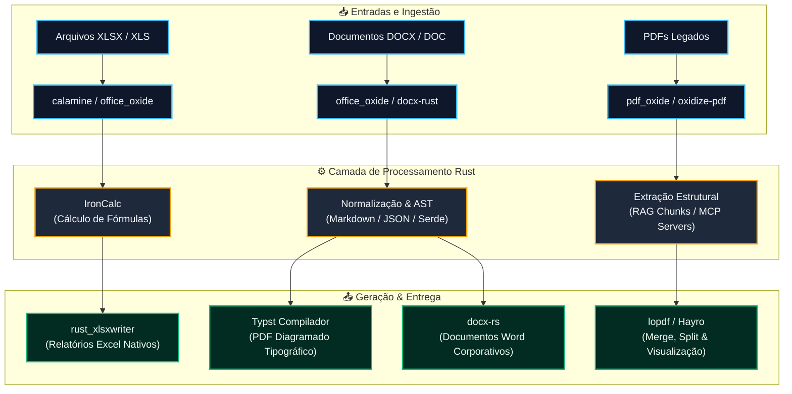

# Benchmark: Office em Rust (XLSX, DOCX, PDF)

> [!NOTE]
> **Resumo Executivo**: Para ambientes de produção hoje, o ecossistema Rust é altamente maduro em **planilhas (XLSX/ODS)** e em **PDF**. No entanto, a manipulação de documentos Word (**DOCX/DOC**) ainda depende de bibliotecas jovens (versões 0.x ou 1.0 recente), e inexiste conversão direta nativa de DOCX para PDF em Rust puro com fidelidade total de layout.

---

## 📊 Matriz Rápida de Decisão

| Necessidade Técnica | Escolha Principal | Alternativa Viável | Maturidade |
| :--- | :--- | :--- | :---: |
| **Ler XLSX / XLS / ODS em volume** | [`calamine`](https://docs.rs/calamine) | [`office_oxide`](https://docs.rs/office_oxide) (inclui XLS legado) | **Alta** |
| **Gerar XLSX com formatação e gráficos** | [`rust_xlsxwriter`](https://rustxlsxwriter.github.io) | [`umya-spreadsheet`](https://docs.rs/crate/umya-spreadsheet/latest) | **Alta** |
| **Editar XLSX existente (in-place)** | [`umya-spreadsheet`](https://docs.rs/crate/umya-spreadsheet/latest) | [`betteroffice-xlsx`](https://docs.rs/crate/betteroffice-xlsx/latest) | **Média** |
| **Recalcular fórmulas sem Excel** | [`IronCalc`](https://docs.rs/crate/ironcalc/latest) | [`betteroffice-xlsx`](https://docs.rs/crate/betteroffice-xlsx/latest) | **Média** |
| **Gerar DOCX novo** | [`docx-rs`](https://docs.rs/crate/docx-rs/latest) (bokuweb) | [`office-toolkit`](https://docs.rs/crate/office-toolkit/latest) | **Média** |
| **Ler/editar DOCX e converter DOC legado** | [`office_oxide`](https://docs.rs/office_oxide) | [`betteroffice-docx`](https://docs.rs/crate/betteroffice-docx/latest) | **Baixa a Média** |
| **Gerar PDF de relatórios** | [`Typst`](https://docs.rs/crate/typst/latest) | [`printpdf`](https://docs.rs/crate/printpdf/latest) | **Alta** |
| **Manipular PDF (merge, split, edição)** | [`lopdf`](https://docs.rs/crate/lopdf/latest) | [`oxidize-pdf`](https://docs.rs/crate/oxidize-pdf/latest) | **Alta** |
| **Extrair texto e estrutura de PDF (RAG / busca)** | [`pdf_oxide`](https://docs.rs/crate/pdf_oxide/latest) | [`oxidize-pdf`](https://docs.rs/crate/oxidize-pdf/latest), `pdf-extract` | **Média** |
| **Renderizar PDF em imagem / bitmap** | [`pdfium-render`](https://docs.rs/crate/pdfium-render/latest) (binário C++) | [`hayro`](https://docs.rs/crate/hayro/latest) (Rust puro) | **Alta / Baixa** |

Os dois líderes consolidados em adoção medida pertencem ao mesmo mantenedor, **John McNamara**: `calamine` soma **14,9 milhões de downloads** (5,0 milhões nos últimos 90 dias) e `rust_xlsxwriter` registra **5,2 milhões de downloads** (2,3 milhões nos últimos 90 dias), segundo o crates.io em outubro de 2026.

---

## 🏗️ Arquitetura Recomendada de Processamento de Documentos



---

## 🎯 Metodologia e Critérios de Análise

Cada projeto listado foi avaliado sob os seguintes prismas de engenharia de software:
1. **Formatos Suportados**: Leitura, escrita, in-place edit, conversão e renderização.
2. **Dependências de Sistema**: Código 100% Rust gerenciado vs. wrappers FFI com dependências C/C++ externas (e.g. Pdfium).
3. **Licenciamento & Governança**: Permissivo (MIT, Apache-2.0) vs. restritivo ou proprietário.
4. **Cadência de Versões**: Releases em 2026, documentação oficial e cobertura de testes.
5. **Integração com o Ecossistema Moderno**: Suporte a WASM, Polars, Serde, CLI e servidores MCP (*Model Context Protocol*).

> [!TIP]
> **Atenção aos números**: Não foram executados benchmarks sintéticos proprietários nesta bateria; as taxas de sucesso e velocidade são declaradas pelos próprios projetos. A maturidade reflete o histórico de mercado, estabilidade da API e densidade de adoção na comunidade.

---

## 📗 1. Planilhas (XLSX / XLS)

Planilha é a categoria mais consolidada em Rust: conta com leitor e escritor de padrão internacional, com releases contínuos em 2026. Entretanto, **nenhuma biblioteca única resolve leitura em lote, edição in-place com estilos e recálculo de fórmulas simultaneamente**.

| Biblioteca | Versão (Data) | Licença | Leitura | Escrita | Edição In-Place | Fórmulas | Formatos | Destaques Técnicos |
| :--- | :---: | :---: | :---: | :---: | :---: | :---: | :---: | :--- |
| [**calamine**](https://docs.rs/calamine) | 0.36.1 *(27/07/2026)* | MIT | ✅ Sim | ❌ Não | ❌ Não | Lê valores | xlsx, xlsm, xlsb, xls, ods | O leitor padrão absoluto da comunidade; 14,9 mi downloads |
| [**rust_xlsxwriter**](https://rustxlsxwriter.github.io) | 0.99.1 *(14/09/2026)* | MIT / Apache-2.0 | ❌ Não | ✅ Sim | ❌ Não | Grava fórmulas | xlsx | Gráficos nativos, formatação rica, WASM, Polars, Serde, streaming com memória constante |
| [**umya-spreadsheet**](https://docs.rs/crate/umya-spreadsheet/latest) | 3.1.0 *(17/08/2026)* | MIT | ✅ Sim | ✅ Sim | ✅ Sim | Grava fórmulas | xlsx, xlsm, csv | Estilos completos, gráficos, imagens, proteção por senha, carga lazy e suporte WASM |
| [**IronCalc**](https://docs.rs/crate/ironcalc/latest) | 0.8.3 *(31/07/2026)* | MIT / Apache-2.0 | ✅ Sim | ✅ Sim | ⚠️ Parcial | **Recalcula** | xlsx | Motor de cálculo avançado, rigorosamente testado contra a suíte de paridade do Excel |
| [**betteroffice-xlsx**](https://docs.rs/crate/betteroffice-xlsx/latest) | 0.3.0 *(28/09/2026)* | Apache-2.0 | ✅ Sim | ✅ Sim | ✅ Sim | **Recalcula** | xlsx | Edição colaborativa via CRDTs (Yrs), renderização direta; recusa gráficos complexos |
| [**office_oxide**](https://docs.rs/office_oxide) | 0.1.13 *(30/09/2026)* | MIT / Apache-2.0 | ✅ Sim | ✅ Sim | ✅ Sim | Sem dados | xlsx, xls *(leitura)* | Converte XLS binário legado para XLSX; CLI, MCP Server e bindings Python, Node, Go, C# |
| [**office-toolkit**](https://docs.rs/crate/office-toolkit/latest) | 1.0.0 *(22/07/2026)* | MIT | ✅ Sim | ✅ Sim | ✅ Sim | Sem dados | xlsx | Interface unificada com abstração idêntica para Word, Excel e PowerPoint |

### Diagnóstico de Uso para Planilhas:
* **Fluxo Padrão de Backend**: A dupla **`calamine` + `rust_xlsxwriter`** é imbatível para pipelines headless (consumo de planilhas enviadas por usuários e exportação de relatórios densos).
* **Edição de Templates Existentes**: Quando a aplicação precisa abrir um `.xlsx` modelo, preencher células pontuais e devolver o arquivo preservando estilos, o **`umya-spreadsheet`** é a escolha madura em versão estável 3.x.

---

## 📘 2. Documentos de Texto (DOCX / DOC)

O ecossistema para documentos de texto é atualmente a frente mais fragmentada do Rust. A geração de arquivos novos a partir de dados estruturados é viável, mas a manipulação de modelos legados e a diagramação visual exigem cautela.

| Biblioteca | Versão (Data) | Licença | Leitura | Escrita | Edição In-Place | DOC Legado | Destaques Técnicos |
| :--- | :---: | :---: | :---: | :---: | :---: | :---: | :--- |
| [**docx-rs**](https://docs.rs/crate/docx-rs/latest) *(bokuweb)* | 0.4.22 *(21/07/2026)* | MIT | ❌ Não | ✅ Sim | ❌ Não | ❌ Não | O gerador mais disseminado; compila para WASM (pacote npm `docx-wasm`) |
| [**docx-rust**](https://docs.rs/crate/docx-rust/latest) | 0.1.11 *(22/01/2026)* | MIT | ✅ Sim | ✅ Sim | ✅ Sim | ❌ Não | Fork aperfeiçoado de `PoiScript/docx-rs`; cadência menor de releases |
| [**office_oxide**](https://docs.rs/office_oxide) | 0.1.13 *(30/09/2026)* | MIT / Apache-2.0 | ✅ Sim | ✅ Sim | ✅ Sim | ✅ Leitura | Converte binários DOC em DOCX; exporta para Markdown limpo, HTML e JSON estruturado |
| [**betteroffice-docx**](https://docs.rs/crate/betteroffice-docx/latest) | 0.3.0 *(28/09/2026)* | Apache-2.0 | ✅ Sim | ✅ Sim | ⚠️ Limitado | ❌ Não | Modelo fortemente tipado, paginação real, renderização PNG e sandboxing anti-DDoS |
| [**office-toolkit**](https://docs.rs/crate/office-toolkit/latest) | 1.0.0 *(22/07/2026)* | MIT | ✅ Sim | ✅ Sim | ✅ Sim | ❌ Não | Criação e mutação fluente compartilhando padrões com módulos XLSX e PPTX |

> [!WARNING]
> **Lacuna Crítica DOCX → PDF**: Não existe hoje conversão DOCX para PDF em Rust puro com preservação de fidelidade tipográfica. O padrão industrial moderno em Rust consiste em **gerar o PDF diretamente via Typst** a partir da mesma fonte de dados, evitando a complexidade do parser do Word.

---

## 📕 3. Ecossistema PDF

O ecossistema PDF em Rust cobre o ciclo completo com excelência, distribuído em ferramentas altamente especializadas:

| Biblioteca | Versão (Data) | Licença | Gerar | Manipular / Editar | Extrair Texto | Renderizar | Destaques Técnicos |
| :--- | :---: | :---: | :---: | :---: | :---: | :---: | :--- |
| [**Typst**](https://docs.rs/crate/typst/latest) | 0.15.1 *(17/07/2026)* | Apache-2.0 | ✅ Markup | ❌ Não | ❌ Não | ❌ Não | Compilador tipográfico de ponta; padrão moderno para relatórios e manuais de alto nível |
| [**printpdf**](https://docs.rs/crate/printpdf/latest) | 0.12.8 *(05/09/2026)* | MIT | ✅ API | ⚠️ Básico | ⚠️ Exp. | ⚠️ Para SVG | Manipulação programática em baixo nível, embedding de fontes com subsetting e imagens vetoriais |
| [**krilla**](https://docs.rs/crate/krilla/latest) | 0.8.2 *(04/06/2026)* | MIT / Apache-2.0 | ✅ API | ❌ Não | ❌ Não | ❌ Não | Primitivas gráficas refinadas (degradês, gradientes, glifos) construídas sobre `pdf-writer` |
| [**lopdf**](https://docs.rs/crate/lopdf/latest) | 0.45.0 *(08/09/2026)* | MIT | ✅ Baixo nível | ✅ Sim | ⚠️ Indireto | ❌ Não | Pilar fundamental do ecossistema: merge, rotação, substituição de tokens e compactação de streams |
| [**oxidize-pdf**](https://docs.rs/crate/oxidize-pdf/latest) | 4.9.0 *(30/08/2026)* | MIT | ✅ Sim | ✅ Sim | ✅ Estrutura | ❌ Não | Recuperação de PDFs corrompidos, validação PDF/A, assinatura digital e chunking para RAG |
| [**pdf_oxide**](https://docs.rs/crate/pdf_oxide/latest) | 0.3.78 *(08/09/2026)* | MIT / Apache-2.0 | ✅ Sim | ✅ Anotações | ✅ Alta precisão | Sem dados | Extração granular por caractere, linha e bounding box; exporta Markdown/HTML; CLI e MCP |
| [**pdf-extract**](https://docs.rs/crate/pdf-extract/latest) | 0.12.1 *(16/09/2026)* | N/D | ❌ Não | ❌ Não | ✅ Sim | ❌ Não | Extrator de texto simples e direto construído como camada sobre o `lopdf` |
| [**pdfium-render**](https://docs.rs/crate/pdfium-render/latest) | 0.9.4 *(06/09/2026)* | N/D | ✅ Sim | ✅ Sim | ✅ Sim | ✅ Fiel | Wrapper do motor Pdfium (Google Chromium); exige binário nativo compilado; compila para WASM |
| [**hayro**](https://docs.rs/crate/hayro/latest) | 0.8.0 *(04/10/2026)* | MIT / Apache-2.0 | ❌ Não | ❌ Não | ❌ Não | ✅ Em CPU | Motor 100% Rust sem blocos `unsafe`; renderiza miniaturas sem nenhuma dependência C++ |

---

## 🏢 4. Suítes Integradas (Estado da Arte)

Nenhuma suíte em Rust é substituta imediata para o Microsoft Office ou LibreOffice em 2026; no entanto, três iniciativas de ponta demonstram o futuro do processamento de escritório:

| Suíte | Interface de Usuário | Camada em Rust | Formatos | Licença | Estágio de Maturidade |
| :--- | :--- | :--- | :--- | :---: | :---: |
| [**BetterOffice**](https://github.com/openooxml/betteroffice) | Web (Next.js) + WASM | Motores de documento (DOCX, XLSX, PPTX) | docx, xlsx, pptx | Apache-2.0 | Crates 0.3.0 (set/2026); foco em backend modular |
| [**GenOffice**](https://github.com/genspark-ai/genoffice) | Electron Multi-App | Sidecar analítico de XLSX (`calamine` + `IronCalc`) | docx, xlsx, pptx, pdf, md | Apache-2.0 | Produção híbrida para workflows assistidos por IA |
| [**ArtCraft (PdfCraft)**](https://www.gadgetpilipinas.net/2026/10/artcraft-adobe-alternatives-rust/) | Desktop Nativo & Web | Pipeline completo, sem Electron | pdf | MIT / Apache-2.0 | Alfa funcional (out/2026); interface CLI e MCP Server |

---

## 🎯 5. Stacks Recomendadas por Cenário Operacional

```
                                  MAPA DE DECISÃO TÉCNICA
┌─────────────────────────────────┬────────────────────────────────────────────┐
│ Cenário de Aplicação            │ Stack Recomendada & Justificativa Técnica  │
├─────────────────────────────────┼────────────────────────────────────────────┤
│ Relatórios Corporativos Nativos │ ➜ Typst (para PDF) + rust_xlsxwriter       │
│                                 │ Typst embute gráficos SVG com precisão     │
│                                 │ milimétrica; rust_xlsxwriter gera gráficos │
│                                 │ e tabelas dinâmicas nativas do Excel.      │
├─────────────────────────────────┼────────────────────────────────────────────┤
│ Ingestão em Lote e Pipelines    │ ➜ calamine + office_oxide                  │
│                                 │ calamine lê XLSX/XLSB/ODS com vazão máxima │
│                                 │ e office_oxide lida com XLS legados.       │
├─────────────────────────────────┼────────────────────────────────────────────┤
│ Edição In-Place de Templates    │ ➜ umya-spreadsheet (XLSX) / docx-rust     │
│                                 │ Abrem, modificam campos e salvam sem       │
│                                 │ destruir o layout original do cliente.     │
├─────────────────────────────────┼────────────────────────────────────────────┤
│ Pipelines de IA, RAG e Busca    │ ➜ pdf_oxide + oxidize-pdf + office_oxide   │
│                                 │ Saída estruturada em Markdown, metadados   │
│                                 │ por página e suporte a Servidores MCP.     │
├─────────────────────────────────┼────────────────────────────────────────────┤
│ Edição no Navegador via WASM    │ ➜ BetterOffice ou rust_xlsxwriter (WASM)   │
│                                 │ Todo o processamento ocorre no cliente sem │
│                                 │ tráfego de dados confidenciais na rede.    │
└─────────────────────────────────┴────────────────────────────────────────────┘
```

---

## ⚠️ Riscos, Lacunas e Boas Práticas

* 🔒 **Fixação de Versões**: Quase todos os crates estão em versões `0.x`. Quebras de API podem ocorrer entre versões menores — sempre trave as dependências no seu `Cargo.lock`.
* 📄 **Conversão Semântica**: Não tente converter `DOCX → PDF` em Rust puro. O caminho consolidado é alimentar um template `Typst` com o mesmo payload JSON usado no Word.
* 📦 **Isolamento em Microsserviços**: Para stacks legadas em PHP, Node ou Python, exponha um micro-serviço Rust via gRPC, HTTP ou utilize os bindings C/FFI fornecidos pelo `office_oxide` e `pdf_oxide`.

---

## 🔗 Referências & Fontes Oficiais

* **Documentação Oficial dos Crates (consultados em 12/10/2026)**:
  * Planilhas: [`calamine`](https://docs.rs/calamine), [`rust_xlsxwriter`](https://rustxlsxwriter.github.io), [`umya-spreadsheet`](https://docs.rs/crate/umya-spreadsheet/latest), [`ironcalc`](https://docs.rs/crate/ironcalc/latest), [`betteroffice-xlsx`](https://docs.rs/crate/betteroffice-xlsx/latest), [`office_oxide`](https://docs.rs/office_oxide), [`office-toolkit`](https://docs.rs/crate/office-toolkit/latest)
  * Documentos: [`docx-rs`](https://docs.rs/crate/docx-rs/latest), [`docx-rust`](https://docs.rs/crate/docx-rust/latest), [`betteroffice-docx`](https://docs.rs/crate/betteroffice-docx/latest)
  * PDF: [`typst`](https://docs.rs/crate/typst/latest), [`printpdf`](https://docs.rs/crate/printpdf/latest), [`krilla`](https://docs.rs/crate/krilla/latest), [`lopdf`](https://docs.rs/crate/lopdf/latest), [`oxidize-pdf`](https://docs.rs/crate/oxidize-pdf/latest), [`pdf_oxide`](https://docs.rs/crate/pdf_oxide/latest), [`hayro`](https://docs.rs/crate/hayro/latest), [`pdfium-render`](https://docs.rs/crate/pdfium-render/latest)
* **Telemetria de Downloads**: [crates.io/crates/calamine](https://crates.io/crates/calamine) e [crates.io/crates/rust_xlsxwriter](https://crates.io/crates/rust_xlsxwriter).
* **Projetos de Código Aberto**: Repositório [BetterOffice GitHub](https://github.com/openooxml/betteroffice), [GenOffice GitHub](https://github.com/genspark-ai/genoffice) e [PdfCraft](https://www.gadgetpilipinas.net/2026/10/artcraft-adobe-alternatives-rust/).
